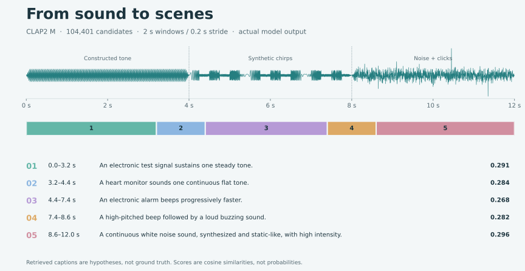
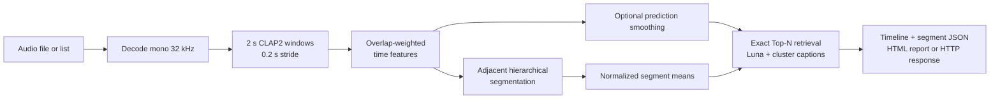

# CLAP2 Audio Scene Segmentation & Caption Retrieval

**Turn a recording into an acoustic timeline—with a ranked set of captions for every time step and every segment.**

This library combines [CLAP2](https://github.com/LAION-AI/clap2) audio embeddings, contiguous temporal clustering, and exact nearest-neighbor retrieval. It returns existing descriptions from a fixed caption library; it does not ask a language model to generate captions at inference time.

The library default is: **CLAP2 M · Luna + 100k · 2-second windows · 200-millisecond stride · Top 5 · adjacent hierarchical segmentation · minimum segment duration of 1 second**. Prediction smoothing uses a centered 1-second moving average. All of these settings are configurable. The [interactive live demo](https://huggingface.co/spaces/TTS-AGI/clap2-live-taxonomy) now starts with **CLAP2 L** and lets you switch between all five model sizes; it shares the same timing and segmentation defaults.



*An actual model run on the included 12-second synthetic recording. The known construction is tone → chirps → noise/clicks; retrieved descriptions are model predictions, not ground truth. Five requested segments can become fewer after minimum-duration merging.*

[**Get all 15 embedding indexes**](https://github.com/LAION-AI/clap2-audio-scene-captioning/releases/tag/v1.0.0) · [**Pipeline and methods**](docs/methods.md) · [**Index format & provenance**](docs/indexes.md) · [**Verification**](docs/verification.md)

## What is included?

- A reusable Python interface for **one file or an ordered list of files**.
- A CLI and a **FastAPI multipart upload service**, including interactive API documentation.
- **All five CLAP2 sizes:** XXS, XS, S, M, and L, with pinned checkpoint revisions.
- Three exact candidate libraries: **10k, 50k, and 100k cluster archetypes plus 4,416 Luna taxonomy sentences**. All three come from the **100-million-caption M clustering**, not the 1M pilot.
- **15 freshly encoded text embedding matrices**, hosted as binary assets in this repository's GitHub release. Candidate strings, IDs, provenance, hashes, and download code are included in Git.
- Five temporal segmentation methods, configurable smoothing, optional contextual patch features, and optional fresh encoding of isolated segments.
- A self-contained HTML audio report with live timeline/segment matches, colored seekable segments, and mono MP3 at 128 kbit/s. Audio playback loads on demand.

## Install

Requires **Python 3.11+** and **FFmpeg** on your `PATH`. Install a PyTorch/torchaudio build appropriate for your CPU or CUDA environment first. The package uses OpenCLIP 4.2.2.

```bash
git clone https://github.com/LAION-AI/clap2-audio-scene-captioning.git
cd clap2-audio-scene-captioning
python -m pip install -e '.[api]'
```

The first use downloads the selected public CLAP2 checkpoint from Hugging Face and the selected text matrix from this repository's release. No access token is required. Subsequent calls reuse the disk cache. Model downloads follow Hugging Face's cache configuration; indexes use `~/.cache/clap2-scenes` or `CLAP2_SCENES_CACHE`.

## Python: one audio or several

```python
from clap2_scenes import SceneCaptioner, AnalysisConfig, SegmentationConfig

captioner = SceneCaptioner(model_size="m", index_size="100k", device="cuda")

# One file returns one dictionary.
result = captioner("recording.wav")
for segment in result["segments"]:
    best = segment["predictions"][0]
    print(segment["start"], segment["end"], best["text"], best["score"])

# A list returns a list in the same order. Top-N is configurable.
results = captioner(["first.wav", "second.mp3"], top_n=10)

config = AnalysisConfig(
    window_seconds=2.0,
    stride_seconds=0.2,
    top_n=5,
    smoothing="gaussian",       # none | moving_average | gaussian
    smoothing_seconds=0.8,      # Gaussian full width at half maximum
    segmentation=SegmentationConfig(
        method="hierarchical",
        target_segments=5,
        min_segment_seconds=1.0,
    ),
)
result = captioner.analyze("recording.wav", config)
```

Windows within a recording are encoded in batches of 64 by default. A list of recordings is processed sequentially to bound GPU memory. Set `audio_batch_size` when constructing the captioner to tune the window batch size. CPU inference is supported with `device="cpu"`.

### Reuse audio features

Change segmentation, smoothing, or Top-N without calling the audio encoder again:

```python
features = captioner.encode("recording.wav")
result = captioner.predict_features(
    features,
    AnalysisConfig(top_n=10, smoothing="none"),
)
```

Changing the window width, stride, or feature method requires new audio encoding. The cached feature object contains NumPy arrays; returned predictions are JSON-serializable. The index can also be reused across a different captioner using the same model checkpoint. Audio and text embeddings from different CLAP2 sizes must never be mixed.

## CLI and playable report

```bash
clap2-scenes analyze examples/synthetic-scene.wav \
  --model m --index 100k --device cuda \
  --window 2 --stride 0.2 --top-n 5 \
  --method hierarchical --segments 5 --min-segment 1 \
  -o predictions.json

clap2-scenes render predictions.json \
  --audio examples/synthetic-scene.wav -o report.html
```

Open `report.html` in a browser. Everything needed for playback is embedded in the file. The [included report](examples/report.html) can also be downloaded and opened locally; see the [browser screenshot](docs/assets/report-desktop.png). Rendering uses the first recording when the JSON contains a batch; pass the corresponding audio file. The CLI always writes a JSON list, even for one input. Supply multiple file paths to `analyze` for a batch.

For every advanced setting, use `--config examples/config.json`. That file replaces the CLI analysis flags; model/index/device flags still apply.

## FastAPI service

```bash
clap2-scenes serve --model m --index 100k --device cuda --port 8000
```

Open **http://127.0.0.1:8000/docs** for the interactive upload form and request schema.

```bash
curl http://127.0.0.1:8000/analyze \
  -F 'files=@recording.wav' \
  -F 'files=@another.mp3' \
  -F 'top_n=5' \
  -F 'config={"window_seconds":2,"stride_seconds":0.2,"segmentation":{"method":"hierarchical","target_segments":5,"min_segment_seconds":1}}' \
  -o predictions.json
```

The response is `{"results": [...]}` in upload order. The service loads one model/index at startup and serializes inference to bound GPU usage. Uploads are temporary and deleted after each request. The default request limit is 300 MB including multipart overhead, with up to 8 files and HTTP Top-N between 1 and 100. `/health` reports the loaded model and index. Python Top-N supports any count up to the candidate count.

For embedding the service in another application:

```python
from clap2_scenes.api import create_app
app = create_app(pipeline=captioner)
```

Environment variables: `CLAP2_MODEL`, `CLAP2_INDEX`, `CLAP2_DEVICE`, `CLAP2_RETRIEVAL_DEVICE`, `CLAP2_SCENES_CACHE`, and `CLAP2_INDEX_PATH`. The CLI binds to localhost by default; `--host 0.0.0.0` exposes it to your network. Model and index choices are server-wide, not per upload.

## What comes back?

Each result contains:

| Field | Content |
|---|---|
| `timeline` | One interval per stride, with ordered Top-N candidate objects and scores |
| `segments` | Contiguous spans covering the entire recording, each with its own Top-N matches |
| `segmentation` | Boundaries, adjacent distances, novelty scores, thresholds, method settings and diagnostics |
| `model`, `index`, `config` | Exact checkpoint, catalog provenance and analysis settings |
| `timing` | Audio encoding and subsequent processing durations for `analyze()` |
| `audio_encoder_rerun` | Whether the call performed audio encoding |

Each candidate includes `id`, `text`, `origin`, `path`, and `score`; cluster candidates additionally include their source `audio_id`, `cluster_id`, and selection-time `centroid_cosine`. **`score` is the current audio-to-text match; `centroid_cosine` is unrelated cluster-selection metadata.**

`AnalysisConfig(include_embeddings=True)` also returns unsmoothed time features and the actual segment query vectors. See the [complete example JSON](examples/synthetic-scene.json).

## How it works



Time-step scores are weighted averages of cosine similarities from overlapping windows. We preserve this interpretation by **not normalizing the averaged time feature again**. Smoothing is applied to features before retrieval; by linearity, this is equivalent to smoothing every candidate's score before taking Top-N. It avoids allocating a full time-by-candidate score matrix.

Segmentation uses normalized time features and acoustic changes, independently of caption choices. The default repeatedly merges the most similar adjacent groups using a duration-weighted Ward-like cost, then merges undersized spans. It was a useful subjective default in the demos; this repository does not claim a measured event-detection accuracy advantage.

For each segment, the default retrieves captions from the normalized duration-weighted mean of the original cached time features. To instead encode the **isolated audio cuts** with CLAP2, set `reencode_segments=True`; each resulting segment must be at most 30 seconds. These are different query definitions and can produce different captions.

See [the methods guide](docs/methods.md) for equations, every hyperparameter, adaptive-threshold tuning, and contextual pooling.

## Index choices

| Selection from 100M M embeddings | Archetype captions available | Luna sentences | Total candidates |
|---|---:|---:|---:|
| 10k clusters | 10,000 | 4,416 | **14,416** |
| 50k clusters | 49,994 | 4,416 | **54,410** |
| 100k clusters | 99,985 | 4,416 | **104,401** |

Six 50k clusters and fifteen 100k clusters have no usable rank-1 caption in the pinned source. They are omitted, and their IDs are recorded in the manifest. We do not replace them with invented text. Every available cluster contributes its **rank-1 archetypal caption**; these are caption embeddings, not centroid vectors.

**The candidate strings and order are identical across model sizes.** They were selected by the existing **M / 100M** clustering and then freshly encoded with each of the five text towers. XXS/XS/S/L indexes do not claim to use archetypes independently selected by those models.

| CLAP2 size | Embedding dimensions | 100k + Luna matrix, FP16 | Resident FP32 vectors |
|---|---:|---:|---:|
| XXS | 224 | 44.6 MiB | 89.2 MiB |
| XS | 320 | 63.7 MiB | 127.4 MiB |
| S | 512 | 102.0 MiB | 203.9 MiB |
| M | 640 | 127.4 MiB | 254.9 MiB |
| L | 960 | 191.2 MiB | 382.3 MiB |

These figures cover vectors only, not the encoder, candidate strings, temporary arrays, or framework memory. All 15 release matrices together are about 880 MiB. See [index details](docs/indexes.md) for download, offline use, memory mapping and integrity checks.

## Limits and interpretation

- Sliding windows accept audio up to **10 minutes**. Contextual patches accept up to **30 seconds**; they are an experimental local pooling method, not a trained timestamp detector.
- Scores are **similarities, not calibrated probabilities**. A high-ranking description is still a hypothesis, particularly for overlapping or ambiguous sounds.
- A 200 ms output grid does not imply 200 ms acoustic resolution: sliding windows see 2 seconds, and smoothing broadens the response further. Centered windows/smoothing also use future context; this is offline analysis.
- Segments partition the recording. They do not isolate simultaneous sources or provide independent tracks for overlapping events.
- Minimum duration takes precedence over the requested segment count. A whole recording shorter than the minimum remains one shorter segment.
- Exact retrieval searches every candidate. CPU memory mapping limits resident vector allocation but still scans the file; it is not an approximate nearest-neighbor index.
- Floating-point precision, device and batch shape can change very close scores and tied ranks. Freshly generated M vectors may differ slightly from older demo caches.

## Development and reproducibility

```bash
python -m pip install -e '.[api,dev]'
pytest -q

# Recreate the pinned text catalogs, then encode all five text towers.
python scripts/prepare_catalogs.py
python scripts/encode_catalogs.py --models xxs xs s m l --device cuda
python scripts/finalize_indexes.py

# Optional real-model integration checks, using local artifacts/*.npy.
CLAP2_TEST_DEVICE=cuda CLAP2_MODEL_CACHE=/path/to/model-cache \
  python scripts/verify_models.py
```

Encoding resumes by skipping models with a completed `artifacts/encoding-*.json` report. Remove that model's report to deliberately recompute it. Rebuilding manifests creates new checksums for your output; if you distribute those files, update release URLs accordingly. `prepare_catalogs.py` requires PyArrow, included in the development extra.

The tests cover parity with the Space's five segmentation algorithms, minimum-duration and coverage invariants, mean-cosine weighting, score/feature smoothing equivalence, exact chunked retrieval, cache validation and HTTP behavior. [Recorded integration checks](docs/verification.md) exercise all five real checkpoints and all 15 matrices. They are functional checks, not a caption-quality benchmark.

## Sources and license

Code is licensed under **Apache-2.0**. Model weights and source data retain their own upstream terms; see [NOTICE](NOTICE) and [data provenance](docs/indexes.md#provenance-and-licenses).

Built on [LAION-AI/CLAP2](https://github.com/LAION-AI/clap2), [OpenCLIP](https://github.com/mlfoundations/open_clip), the [LAION-Audio-XL caption cluster library](https://huggingface.co/datasets/laion/laion-audio-xl-caption-cluster-library), and [LAION-Audio-XL embeddings](https://huggingface.co/datasets/laion/laion-audio-xl-embeddings). The included audio example is generated by this repository's own script.
